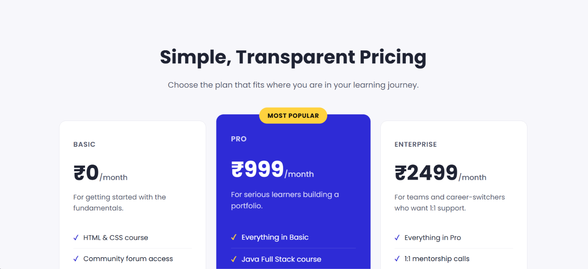
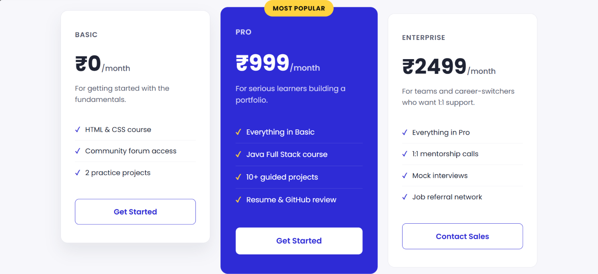

# Pricing Plans

A clean and responsive pricing plans webpage built using HTML5 and CSS3 as a frontend learning project.

## 📌 About the Project

This project is a pricing plans webpage designed for the BrightPath learning platform.

It displays three pricing options — Basic, Pro, and Enterprise — with different features and pricing details.

The project focuses on creating a clean pricing layout, highlighting the recommended plan, adding hover effects, and making the page responsive for different screen sizes.

## ✨ Features

* Three pricing plans
* Basic, Pro, and Enterprise plans
* Highlighted Pro plan
* "Most Popular" badge
* Responsive pricing card layout
* CSS hover effects
* Smooth visual transitions
* Responsive design for different screen sizes
* Clean and modern user interface

## 🛠️ Technologies Used

* HTML5
* CSS3
* Google Fonts (Poppins)

## 📂 Project Structure

```text
pricing-plans/
│
├── index.html
├── styles.css
├── README.md
└── screenshots/
    ├── pricing-page-1.png
    └── pricing-page-2.png
```

## 🚀 How to Run

1. Clone this repository:

```bash
git clone https://github.com/Lokeswari684/pricing-plans.git
```

2. Open the project folder.

3. Open `index.html` in a web browser.

No additional installation or dependencies are required.

## 🎯 Learning Outcomes

Through this project, I practiced:

* Structuring webpages using HTML
* Creating pricing cards using CSS
* Using CSS Grid for layout
* Using Flexbox for alignment
* Highlighting a featured pricing plan
* Creating hover effects and transitions
* Using responsive design techniques
* Working with media queries
* Improving spacing, typography, and visual presentation

## 📸 Project Preview

### Pricing Page - Part 1



### Pricing Page - Part 2



## 👩‍💻 Author

**Lokeswari Gonugunta**

GitHub: [Lokeswari684](https://github.com/Lokeswari684)
